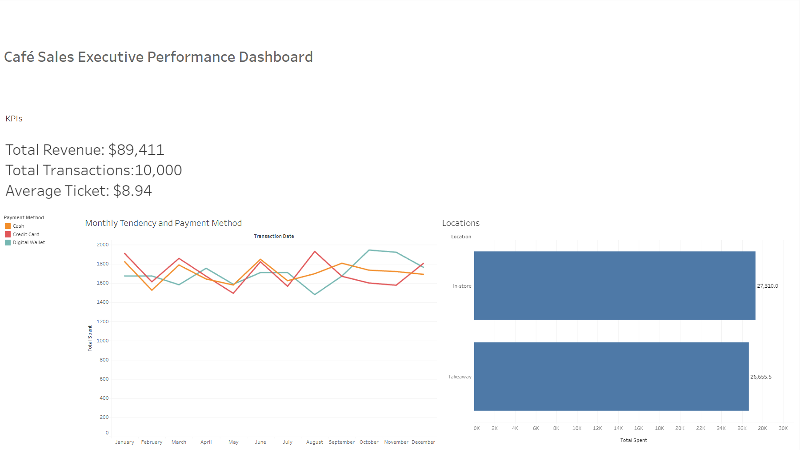

# Cafe Sales: Data Cleaning, SQL Analytics & BI

## Business Question
Which items, payment methods, and locations drive revenue, and how reliable is the data behind those answers?

## Executive KPIs
* **Total Revenue:** $89,411.00
* **Total Transactions:** 10,000
* **Average Ticket:** $8.94

## Dataset
Cafe Sales (dirty) from Kaggle: 10,000 transactions with missing values, `"ERROR"`/`"UNKNOWN"` placeholders, and inconsistent data types.

## Approach
1. Standardized column names and replaced text placeholders with real nulls.
2. Fixed data types (numeric, datetime, category).
3. Recovered missing values using mathematical/algebraic relationships (`Total = Quantity × Price`, item ↔ price lookup catalog).
4. Validated the result with strict assertions (`assert`).
5. Performed Exploratory Data Analysis (EDA) in Python and ingested clean data into SQLite for analytical querying (CTEs, Window Functions) and Tableau for executive visualization.

## Key Cleaning Decisions
| Issue | Decision | Impact |
|---|---|---|
| Text placeholders (`'UNKNOWN'`, `'ERROR'`, `'N/A'`) | Converted to real `NaN` values | **3,256** cells standardized |
| Missing `Item` | Inferred via reverse lookup using the `Price Per Unit` catalog | **969** values recovered |
| Missing `Price Per Unit` | Recovered from `Total Spent / Quantity` or item catalog median | **533** values recovered |
| Missing `Quantity` | Recovered from `Total Spent / Price Per Unit` | **479** values recovered |
| Missing `Total Spent` | Recalculated as `Quantity × Price Per Unit` | **502** values recalculated |
| Missing Transaction Dates | Forward fill (`ffill`) after sorting sequentially by `Transaction ID` | **460** date values recovered |
| Remaining nulls (`Payment Method`, `Location`) | Kept as `NaN`: no reliable way to infer without distorting distribution | **7,139** values preserved as missing |

## Data Quality: Before vs After

* Recovered **2,943** missing values while maintaining all **10,000** records (0 row deletion).

## Exploratory Data Analysis (Python Visuals)
* **Revenue by Item:** Juice leads overall revenue (21.3%), followed closely by Salad.
  

* **Monthly Revenue Trend:** Monthly revenue fluctuates between $6.7k and $7.5k.
  

* **Payment Method Distribution:** Balanced distribution across known channels (~$20.5k each), with ~31% unmapped payment records.
  

## Executive Dashboard (Tableau)


## Repository Structure
```text
cafe-sales-etl-bi/
├── data/
│   ├── raw_cafe_sales.csv        # Raw dataset
│   └── clean_cafe_sales_v1.csv   # Cleaned dataset
├── docs/
│   └── figures/                  # EDA charts (matplotlib/seaborn)
├── notebooks/
│   └── cleaning.ipynb            # Python ETL, Imputation logic & EDA
├── sql/
│   └── queries.sql               # CTEs, Window Functions & Aggregations
├── dashboard/
│   └── dashboard_cafe.png        # Executive Tableau Dashboard export
└── README.md
## SQL Analytics
All queries are available in `sql/queries.sql`, covering:
* **Revenue Breakdown:** By payment method and location using `PARTITION BY`.
* **Running Totals:** Cumulative monthly revenue growth using `OVER (ORDER BY month)`.
* **Product Rankings:** Item revenue performance ranked via `RANK()`.

## How to Run
1. Place raw dataset in `data/raw_cafe_sales.csv`.
2. Run `notebooks/cleaning.ipynb` to execute the cleaning pipeline and generate plots in `docs/figures/`.
3. Query `data/clean_cafe_sales_v1.csv` via SQLite or open `sql/queries.sql`.

## Tech Stack
* **Data Processing & EDA:** Python (Pandas, NumPy, Matplotlib, Seaborn)
* **Database & Querying:** SQLite
* **Business Intelligence:** Tableau Public

## Limitations
* The dataset exhibits synthetic characteristics (even revenue distribution across payment channels).
* Single-year temporal span without specified currency units.